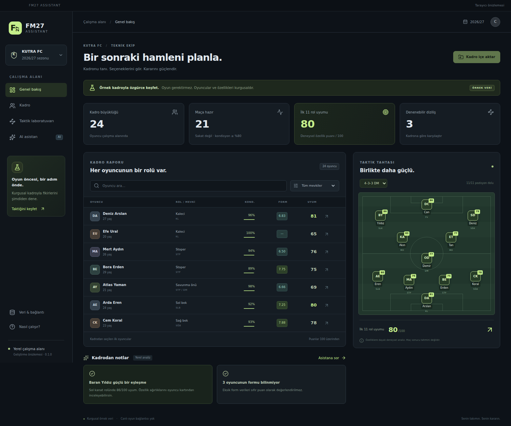

# FM27 Assistant

Can için özel, oyun öncesinde de kullanılabilen bir taktik çalışma alanı.
Aktif geliştirme **Rust + Tauri 2 + React + SQLite** üzerinde `desktop/` altında sürüyor.

## İlk Rust Mac sürümü — 6 Kasım 2026

[Apple Silicon paketini indir](https://github.com/cozcanco-hash/Fm27-Assistant/actions/runs/42180058741/artifacts/13485093096).
İndirilen ZIP içinde `.dmg`, `.app` arşivi ve SHA-256 kontrol dosyası bulunur.
Paket 20 Kasım 2026'ya kadar saklanır; sonraki derlemeler Actions bölümünden alınabilir.
Bu, ad-hoc imzalı bir geliştirici önizlemesidir.

[Doğrulanan kaynak: `fa66465`](https://github.com/cozcanco-hash/Fm27-Assistant/commit/fa66465e02e145e6f7ca0ca4827ff5e85248ee39).
[Başarılı test ve paketleme çalıştırması](https://github.com/cozcanco-hash/Fm27-Assistant/actions/runs/42180058741):
**21 Rust testi + 4 arayüz testi başarılı**. Mac'teki gerçek paket WebView'i açtı;
React arayüzü Rust/SQLite çekirdeğinden 24 oyuncuyu ve 11 kişilik öneriyi yükledi.

| Apple Silicon CI ölçümü | Sonuç |
| --- | --- |
| Uygulama paketi | 7,72 MiB |
| DMG | 3,35 MiB |
| Açılış → arayüz ve veri hazır | 4,152 saniye |
| Sentetik 5.000 oyuncu / ilk 11 analizi | Ortanca 7,01 ms; p95 11,96 ms (25 tekrar) |

Ölçümler GitHub'ın Apple Silicon test ortamına aittir. Analiz süresi yerel rol ve
ilk 11 hesabını kapsar. Kullanıcının Mac'inde ChatGPT girişi ve gerçek oyun verisiyle
test henüz yapılmadı. Rust sürümünün kapsamı Java referansından farklı olduğu için
bu rakamlar birebir Java/Rust hız karşılaştırması olarak sunulmaz.



## Rust sürümünde

- 24 kurgusal oyuncuyla hemen başlayan çalışma alanı.
- Kadro arama, mevki filtresi, oyuncu özellikleri ve açıklanabilir rol puanları.
- 4–3–3 DM, 4–2–3–1 ve 4–4–2 saha görünümü; aynı oyuncuyu iki kez seçmeyen ilk 11 analizi.
- Doğrulamalı özel JSON kadro aktarımı ve Mac'te kalıcı SQLite kaydı.
- Yerel Codex üzerinden ChatGPT girişi, model seçimi ve akış halinde AI sohbeti.

**Oyun sahibi olman gerekmiyor.** Örnek kadro tamamen kurgusal; gerçek FM27
verisi veya oyuna canlı bağlantı içermiyor. Bu ilk Rust sürümü, Java projesindeki
tüm özelliklerin taşındığı bir sürüm değildir. Gerçek hesap ve oyun testi ayrıca yapılacak.

- [Kurulum, geliştirme ve veri şeması](desktop/README.md)
- [Rust testleri ve Apple Silicon paketleri](https://github.com/cozcanco-hash/Fm27-Assistant/actions/workflows/rust-desktop.yml)
- [Kurgusal örnek kadro](desktop/fixtures/demo-squad.json)
- [Önceki Java önizlemesi ve doğrulaması](JAVA_PREVIEW.md)

```bash
cd desktop
npm ci
npm run desktop:dev
```

Geliştirme için Rust, Node.js 24 ve Xcode komut satırı araçları gerekir.
Derlenmiş Mac uygulamasında Rust, Node veya Java kurulumu gerekmez.
ChatGPT özellikleri için resmi Codex CLI ve kullanıcının kendi hesabıyla giriş gerekir.

## Kaynak geçmişi

Java referansı [JelmerBouma1985/fm-ai-assistent](https://github.com/JelmerBouma1985/fm-ai-assistent)
projesinin `a06ac845acfd6c0eccbd61e3a633b3518584e457` commitinden aktarılmıştır.
Orijinal dokümantasyon [README_UPSTREAM.md](README_UPSTREAM.md) dosyasında korunur.
Rust çalışma alanı bu depoda yeni uygulanmıştır. Depo özel tutulur; upstream kod
üzerinde yeni bir lisans hakkı beyan edilmez.
